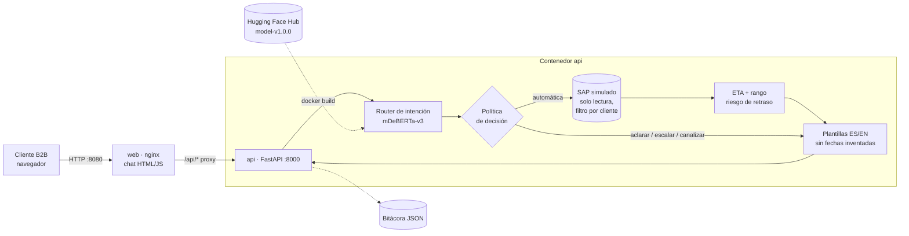

# Chatbot de estatus de órdenes y ETA · CAB (Proyecto Fase 2)

**Maestría en Inteligencia Artificial · Gestión de proyectos de inteligencia artificial**
T07175241 · Gabriel Alejandro García Ángeles

Solución técnica completa y desplegable del prototipo definido en la Fase 1: un chatbot para que los
clientes B2B de **Componentes Automotrices del Bajío (CAB)**, una empresa ficticia, consulten el estatus de
sus órdenes de compra y la fecha estimada de entrega. Integra en una API los modelos construidos en las
actividades anteriores, los empaqueta con Docker y queda listo para desplegarse en la nube.

| Componente | Origen | Qué hace |
|---|---|---|
| Router de intención (mDeBERTa-v3 ajustado) | A4 + data-v3.0.0 (Fase 2) | Entiende el mensaje en español o inglés y decide: responder, preguntar o escalar |
| Modelo de ETA (regresión con rango) | Nuevo en la Fase 2 | Estima en cuántos días llega la orden, con rango y motivos |
| Clasificador de riesgo de retraso | A6 (gradient boosting, umbral 0.17) | Marca órdenes con probabilidad alta de llegar tarde |
| SAP simulado (solo lectura) | Datos del piloto de la A6 | Estatus de las órdenes, siempre filtrado por cliente |
| API REST (FastAPI) + chat web (nginx) | Nuevo en la Fase 2 | Integración backend–frontend |

> Todos los datos son simulados. Es un prototipo académico, no un sistema en producción.

## Arquitectura



En local la solución corre en **dos contenedores** (`web` y `api`) con `docker compose`. En la nube se usa
**una sola imagen** (`Dockerfile` de la raíz), que también entrega el chat en `/`.

## Estructura del repositorio

```
ProyectoFase2/
├── Dockerfile                  Imagen de la API (+ frontend estático para la nube)
├── docker-compose.yml          Ejecución local: web (nginx) + api (FastAPI)
├── .env.example                Variables de configuración
├── backend/
│   ├── app/                    Código de la API (main.py, router, política, SAP, ETA, plantillas)
│   ├── modelos/                Modelos de ETA y riesgo (.joblib) + metadatos_modelos.json
│   ├── tests/                  Pruebas automáticas (pytest)
│   └── requirements.txt        Dependencias con versión exacta
├── frontend/                   Chat web (HTML/CSS/JS), nginx.conf y su Dockerfile
├── datos/
│   ├── entregas/               data-v1.0.0 (A6): histórico y piloto
│   └── mensajes_cab/           data-v3.0.0: mensajes para el router + prueba externa escrita a mano
├── entrenamiento/              Generadores de datos, entrenamiento de modelos y cuaderno de Colab
├── pruebas/                    Pruebas funcionales (contra el contenedor) y de estrés/drift
├── resultados/                 Métricas, predicciones y figuras
├── despliegue/                 Script de publicación en Hugging Face Spaces
└── docs/                       Manual de despliegue, documento de validación y capturas
```

## Requisitos

- Docker Desktop 4.x (Windows/macOS) o Docker Engine 24+ con Compose v2 (Linux).
- 4 GB de RAM para Docker y unos 10 GB de disco (la imagen de la API descarga 1.5 GB y ocupa 4.4 GB descomprimida).
- Conexión a internet la primera vez (descarga de la imagen base, PyTorch y el modelo).
- Opcional, para las pruebas funcionales: Python 3.10 o superior (solo librería estándar).

## Ejecución local

```bash
git clone https://github.com/gagarang25/ProyectoFase2.git
cd ProyectoFase2
cp .env.example .env                       # en PowerShell: copy .env.example .env
docker compose build --build-arg GIT_COMMIT=$(git rev-parse --short HEAD)
docker compose up -d
docker compose ps                           # ambos servicios deben quedar "healthy"
```

- Chat: <http://localhost:8080>
- Documentación interactiva de la API (Swagger): <http://localhost:8080/docs> o <http://localhost:8000/docs>
- Salud y versiones: <http://localhost:8000/api/salud>

Solo la API, sin compose:

```bash
docker build -t cab-chatbot-api:1.0.0 .
docker run --rm -p 8000:8000 cab-chatbot-api:1.0.0   # el chat también queda en http://localhost:8000
```

Detener y limpiar: `docker compose down`.

## Endpoints

| Método | Ruta | Autenticación | Descripción |
|---|---|---|---|
| GET | `/api/salud` | — | Estado, versiones de modelos, datos y commit |
| POST | `/api/intencion` | — | Intención, confianza, probabilidades y acción |
| POST | `/api/chat` | Bearer | Flujo completo de la conversación |
| GET | `/api/ordenes` | Bearer | Órdenes del cliente autenticado |
| GET | `/api/ordenes/{oc}` | Bearer | Estatus de una OC (404 si no es del cliente) |
| GET | `/api/ordenes/{oc}/eta` | Bearer | Fecha estimada, rango, motivos y riesgo |
| POST | `/api/eta/estimar` | — | ETA y riesgo para datos de una orden |

Tokens de demostración (los 5 clientes del piloto): `demo-arm01`, `demo-arm03`, `demo-arm04`, `demo-arm07`,
`demo-tier02`.

```bash
curl -s -X POST http://localhost:8000/api/chat \
  -H "Authorization: Bearer demo-arm01" -H "Content-Type: application/json" \
  -d '{"mensaje": "¿Cuándo llega la OC 4500127991?"}'
```

## Pruebas

```bash
docker compose exec api pytest -q                 # pruebas automáticas dentro del contenedor (incluye el modelo real)
python pruebas/pruebas_funcionales.py             # 35 casos funcionales y extremos + prueba externa + latencia
python pruebas/estres_drift.py                    # escenarios de drift y análisis de falsos negativos
```

Los resultados se guardan en `pruebas/resultados/` y `resultados/`. El análisis completo está en
`docs/Fase2_Validacion_Pruebas_GAGA.pdf`.

## Entrenamiento y versiones

| Elemento | Versión | Dónde |
|---|---|---|
| Datos de entregas | `data-v1.0.0` (A6, SHA-256 `677bab16…`) | `datos/entregas/` |
| Mensajes del router | `data-v3.0.0` | `datos/mensajes_cab/versiones.json` |
| Router mDeBERTa-v3 | `model-v1.0.0` | Hugging Face Hub (`config_cab.json` guarda el commit de entrenamiento) |
| Modelos de ETA y riesgo | `model-v1.0.0` | `backend/modelos/metadatos_modelos.json` |
| Aplicación | `app-v1.0.0` | Etiqueta de Git y `/api/salud` |

- Router: `entrenamiento/router_mdeberta_colab.ipynb` (GPU T4 de Colab) ejecuta `entrenar_router.py` y
  `publicar_modelo_hf.py`.
- ETA y riesgo: `python entrenamiento/entrenar_modelos_entrega.py` (CPU, menos de 2 minutos).
- Datos: `python entrenamiento/generar_mensajes_cab.py` y `python entrenamiento/generar_datos_entregas.py`.

## Despliegue en la nube

El paso a paso, los requerimientos y la estrategia (contenedores sobre un PaaS) están en
`docs/Fase2_Manual_Despliegue_GAGA.pdf`. La plataforma principal es **AWS Elastic Beanstalk** (la del tutorial del
Tema 16), con Google Cloud Run y Azure Container Apps como alternativas. Todas usan la misma imagen del `Dockerfile`:

```bash
# Simulación del PaaS: la imagen sola, sin nginx ni compose (el chat queda en http://localhost:8001)
docker run -d --name cab-nube -p 8001:8000 cab-chatbot-api:1.0.0
python pruebas/pruebas_funcionales.py --url http://localhost:8001

# AWS Elastic Beanstalk (requiere cuenta de AWS; instancia de 4 GB porque la API usa 1.8 GB)
pip install awsebcli
eb init -p docker cab-chatbot --region us-east-1
eb create cab-chatbot-env --instance_type t3.medium --single
eb open
```

`despliegue/publicar_space.py` publica la misma imagen en Hugging Face Spaces, pero durante el proyecto la plataforma
empezó a exigir suscripción PRO para los Spaces con Docker (error 402), por eso no hay demo pública.

## Documentos

- `docs/Fase2_Manual_Despliegue_GAGA.pdf`: manual de despliegue (estructura de la plantilla ISO/IEC 23053 del Tema 16).
- `docs/Fase2_Validacion_Pruebas_GAGA.pdf`: pruebas funcionales, casos extremos, drift y resultados.
- `docs/evidencias/` y `docs/capturas/`: salidas de Docker, pytest, pruebas funcionales y capturas.

## Limitaciones

- Los datos de entregas y los mensajes de CAB son simulados; la prueba externa la escribió el autor.
- El ETA se estima desde la fecha del pedido y no se actualiza con eventos de rastreo del transportista.
- La autenticación usa tokens fijos de demostración; en producción se usaría un proveedor de identidad.
- Las respuestas usan plantillas; el modelo de lenguaje generativo de la Fase 1 queda como mejora opcional.
